# 📡 Telecom Customer Intelligence System (TCIS)
### Enterprise-Grade Multi-Task AI Analytics, Hierarchical Classification & Outage Surveillance Platform

[](https://www.python.org/)
[](https://fastapi.tiangolo.com/)
[](https://pytorch.org/)
[](https://huggingface.co/)
[](https://www.chartjs.org/)
[](https://maartengr.github.io/BERTopic/)
[](LICENSE)

---

## 📑 Table of Contents
- [Executive Overview](#-executive-overview)
- [System Architecture & Model Topology](#-system-architecture--model-topology)
- [Quick Start Guide](#-quick-start-guide)
- [End-to-End User Guide & Platform Modules](#-end-to-end-user-guide--platform-modules)
  - [1. Live Intelligence Studio](#1-live-intelligence-studio)
  - [2. Collective Outage Surveillance & Clustering](#2-collective-outage-surveillance--clustering)
  - [3. Model Benchmark & Evaluation Matrix](#3-model-benchmark--evaluation-matrix)
  - [4. Batch CSV Processing & REST API](#4-batch-csv-processing--rest-api)
- [Mathematical Surveillance Formulations](#-mathematical-surveillance-formulations)
- [API Reference & Endpoints](#-api-reference--endpoints)
- [Directory Structure](#-directory-structure)

---

## 🌐 Executive Overview

The **Telecom Customer Intelligence System (TCIS)** is an end-to-end AI platform engineered for telecom operators to automate omnichannel customer triage, resolve complaint escalations, enforce strict hierarchical service classification, and detect anomalous collective network outages in real time.

Operating over **36,417 telecom customer records**, the platform integrates **6 optimized RoBERTa neural networks (FP16)** with statistical anomaly surveillance (Poisson scanning window & Benjamini–Hochberg False Discovery Rate control) and semantic clustering (**228 BERTopic clusters**).

```
   Raw Feedback / Chat Log
             │
             ▼
   [RoBERTa Neural Pipeline]
   ├── Complaint Status (Complaint / Non-Complaint / Ambiguous)
   ├── Customer Sentiment (Negative / Neutral / Positive / Mixed)
   ├── Operational Severity (High/Critical / Medium / Low)
   └── Hierarchical Decoding (13 Services ➔ 38 Categories ➔ 17 Specific Issues)
             │
             ├──► [Composite SLA Priority Engine] (0 - 100 Score & Routing)
             ├──► [BERTopic Anomaly Attribution] (24h Poisson Surveillance)
             └──► [Generative Incident Synopsis] (FLAN-T5 Synthesis)
```

---

## 🏗️ System Architecture & Model Topology

```
                  ┌──────────────────────────────────────────────┐
                  │         Customer Interaction Feed            │
                  │   Single Message / Dual-Speaker Dialogue     │
                  └──────────────────────┬───────────────────────┘
                                         │
                    ┌────────────────────┴────────────────────┐
                    │                                         │
                    ▼                                         ▼
         [Clean Input Text]                       [Customer Extraction]
                 │                                            │
                 ▼                                            ▼
   ┌───────────────────────────┐                ┌───────────────────────────┐
   │ msg_complaint_roberta     │                │ msg_sentiment_roberta     │
   │ Output: Binary/Ambiguous  │                │ Output: 4-Way Sentiment   │
   └─────────────┬─────────────┘                └─────────────┬─────────────┘
                 │                                            │
                 ├─────────────────────┬──────────────────────┤
                 │                     │                      │
                 ▼                     ▼                      ▼
   ┌───────────────────────────┐ ┌───────────────┐ ┌────────────────────────┐
   │ msg_severity_roberta      │ │ msg_services  │ │ msg_L2_roberta         │
   │ Output: High/Med/Low      │ │ 13 Multi-Lbl  │ │ 38 Problem Categories  │
   └─────────────┬─────────────┘ └───────┬───────┘ └───────────┬────────────┘
                 │                       │                     │
                 │                       ▼                     ▼
                 │             ┌────────────────────────────────────────────┐
                 │             │      Constrained Hierarchical Decoder      │
                 │             │     L1 (Services) ➔ L2 ➔ L3 (Resolution)   │
                 │             │   Strict Taxonomic Beam Constraint Filter  │
                 │             └─────────────────────┬──────────────────────┘
                 │                                   │
                 ▼                                   ▼
   ┌───────────────────────────┐       ┌────────────────────────────────────┐
   │ Composite SLA Triage      │       │ BERTopic Attribution & Surveillance│
   │ Urgency Score (0 - 100)   │       │ Poisson Window (24h) + FDR q-value │
   └─────────────┬─────────────┘       └─────────────────┬──────────────────┘
                 │                                       │
                 └───────────────────┬───────────────────┘
                                     │
                                     ▼
                      ┌─────────────────────────────┐
                      │ Generative Incident Summary │
                      │ FLAN-T5 Structured Synopsis │
                      └─────────────────────────────┘
```

---

## 🚀 Quick Start Guide

### Prerequisites
- Windows 10/11 or Linux
- Python 3.10+ with CUDA or CPU support
- Modern web browser (Chrome, Edge, Firefox)

### Method 1: One-Click Startup (Recommended for Windows)
Simply double-click the included batch launcher:
```bat
run_tcis.bat
```

### Method 2: Command Line (PowerShell / Terminal)
```powershell
cd "D:\corces AI enginering\DeepLearning\tcis_models_archive_optimized"
python run_server.py
```

### Platform Endpoints:
| Service | URL | Description |
| :--- | :--- | :--- |
| **Main Analytical Dashboard** | [http://127.0.0.1:8000](http://127.0.0.1:8000) | Live Studio, Surveillance, Benchmark, Batch Processing |
| **Executive Presentation Deck** | [http://127.0.0.1:8000/presentation](http://127.0.0.1:8000/presentation) | 7-Slide Interactive Deck with KaTeX Math Formulations |
| **REST API Documentation** | [http://127.0.0.1:8000/docs](http://127.0.0.1:8000/docs) | Interactive Swagger UI & OpenAPI Specification |

---

## 🖥️ End-to-End User Guide & Platform Modules

### 1. Live Intelligence Studio

The **Live Studio** allows operators to analyze unstructured customer messages or dual-speaker transcripts (`[CUSTOMER]` and `[COMPANY]`) in real time with sub-second inference.

#### Step 1: Input Setup & Scenario Selection
Users can type raw text into the input console or select pre-configured telecom scenarios:
- *Home Fiber Outage & Router Optical Alarm*
- *Collective Outage Anomaly: iPhone Trade-in & Plan Billing (Cluster 3)*
- *Watchlist Candidate: Support Portal 502 Downtime (Cluster 101)*
- *SIM Swap & Network Deactivation (Cluster 17)*
- *Severe Throughput Degradation & Streaming Buffer*
- *Polite General Inquiry / Non-Complaint*

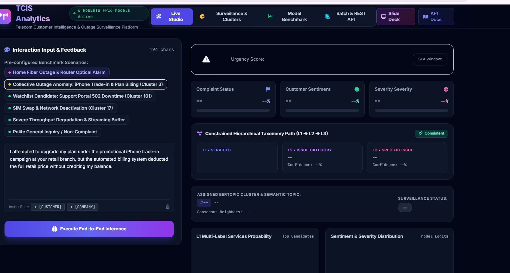

#### Step 2: Running Inference & SLA Response Triage
Click **"Execute End-to-End Inference"**. Within milliseconds, the engine executes the 6-model pipeline:
1. **Operational Urgency Banner**: Calculates a composite priority score ($0 - 100$), assigns an operational priority level (`Low/Normal`, `Medium`, `Critical`), calculates the contractual **SLA Window** (`Within 24 hours`, `Within 2 - 4 hours`, or `Within 15 - 30 minutes`), and records the warm inference latency.
2. **Core Triplet Indicators**:
   - **Complaint Status**: Binary probability distribution (`Complaint`, `Non-Complaint`, `Ambiguous`).
   - **Customer Sentiment**: Emotion valence distribution (`Positive`, `Neutral`, `Negative`, `Mixed`).
   - **Severity Assessment**: Incident operational impact level (`Low`, `Medium`, `High/Critical`).
3. **Constrained Hierarchical Taxonomy Pathway**:
   - Visualizes vertical alignment: **L1 Services** $\to$ **L2 Issue Category** $\to$ **L3 Specific Resolution**.
   - Validates architectural consistency (`Consistent` / `Conflict Resolved`).

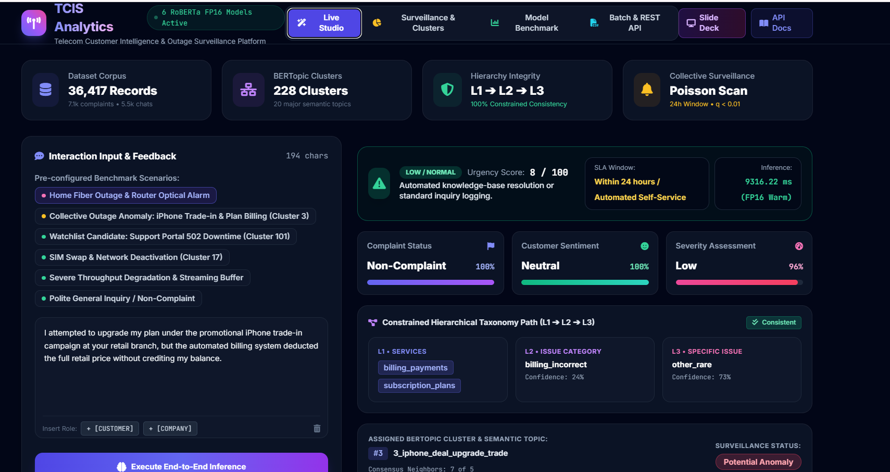

#### Step 3: Probabilities, Doughnut Visualizations & Generative Summary
- **Multi-Label Service Probability Chart**: Displays ranked sigmoid probabilities for top candidate telecom services.
- **Model Logits Distribution**: Interactive doughnut chart breaking down full class probability distribution.
- **FLAN-T5 Structured Summary**: Generates a standardized technical incident report detailing Affected Services, Primary Symptoms, and Probable Root Causes with a one-click copy button.
- **Unified JSON Response**: Collapsible raw payload for developer inspection and downstream API integration.

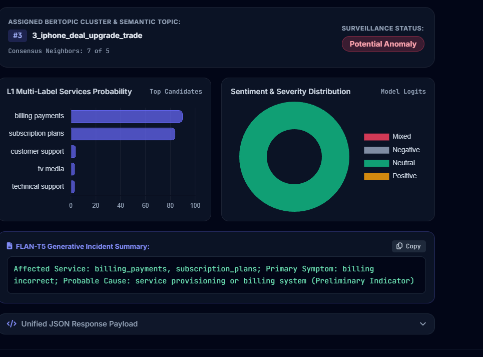

---

### 2. Collective Outage Surveillance & Clustering

This module acts as an automated early warning system for Network Operations Centers (NOC). It monitors unexpected surges across **228 semantic clusters** using continuous 24-hour Poisson scan statistics.

#### Active Anomaly Detection & Statistical Alerts
- **Poisson $p$-scan**: Probability of observing the current 24-hour volume under stationary Poisson baselines ($p < 0.001$).
- **FDR Adjusted $q$-value**: Benjamini–Hochberg False Discovery Rate control ($q < 0.05$) to prevent false alarms across hundreds of simultaneous clusters.
- **Outage Keyword Density & Carrier Acknowledgment Rates**: Tracks keyword mentions (e.g., *down*, *outage*, *flashing red*) and frontline agent acknowledgment percentages.

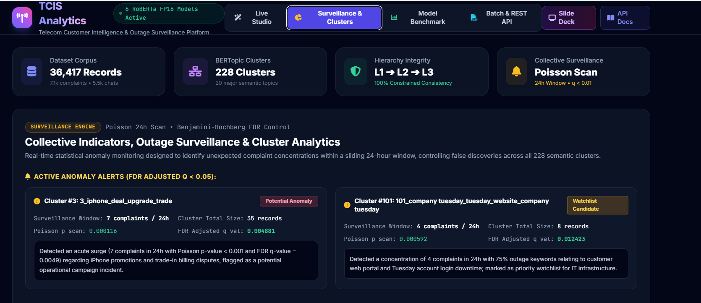

#### Cluster Frequency & Domain Composition Visualizations
- **Cluster Volume & Topic Distribution**: Interactive bar chart displaying complaint volumes for the top 10 telecom clusters.
- **Service Category Distribution**: Doughnut visualization illustrating complaint mass breakdown across `mobile_network`, `internet_service`, `customer_support`, `billing_payments`, and `technical_support`.

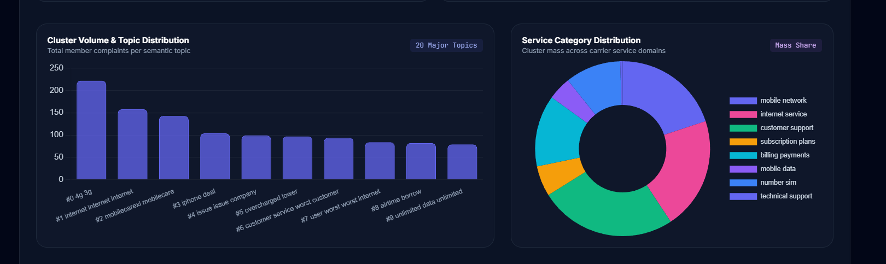

#### Daily Service Volume Spikes & Searchable Explorer
- **Daily Service Surges ($Z$-Score $\ge 3.0$)**: Bar chart and tabular breakdown of anomalous volume bursts by date and service domain.
- **BERTopic Cluster Explorer**: Live, searchable registry of all semantic clusters with representative n-grams, member counts, and domain classifications.

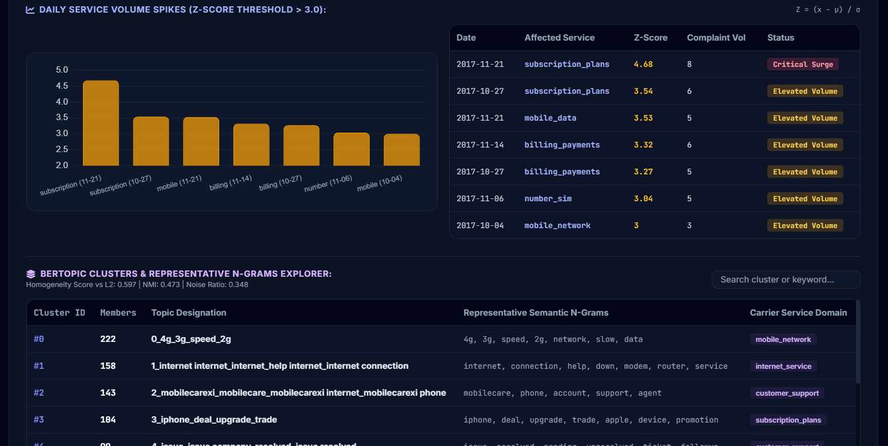

---

### 3. Model Benchmark & Evaluation Matrix

Provides empirical scientific rigor by comparing the optimized **RoBERTa FP16** neural models against competitive baselines (**LinearSVC**, **Logistic Regression**, **Multinomial Naive Bayes**, **BERT Base**, and **DeBERTa-v3**) across all 12 operational telecom tasks.

#### Cross-Task Macro-F1 Performance
The evaluation employs unweighted Macro-F1 to ensure unbiased performance assessment across highly imbalanced classes.

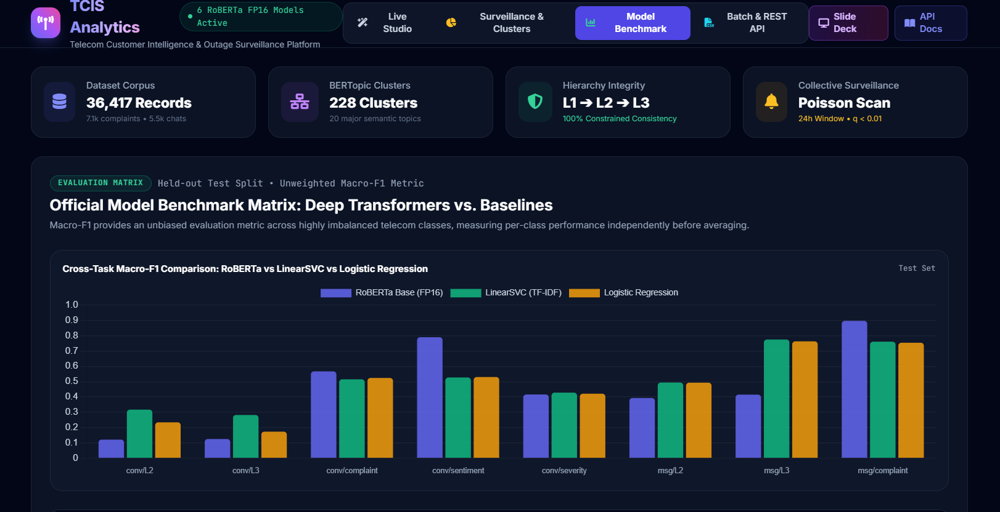

#### Benchmark Matrix Table
The interactive table highlights the winning model for each classification task on the held-out test split:

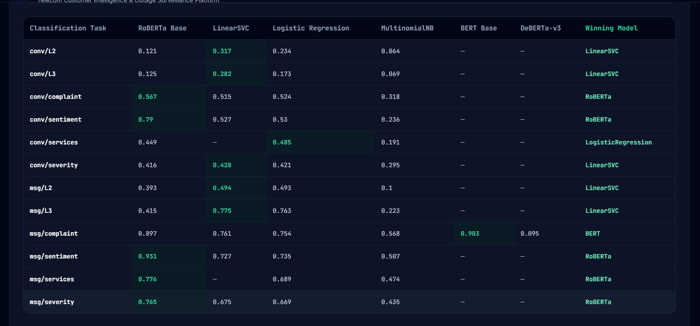

#### Key Architectural Takeaways
1. **RoBERTa Dominates Contextual Tasks**: Achieves state-of-the-art Macro-F1 on message-level sentiment (**0.931**), multi-label services (**0.776**), and severity (**0.765**).
2. **LinearSVC Leads Sparse Hierarchies**: Outperformed deep transformers on fine-grained resolution routing (L3) with **0.775 vs 0.415**, proving that regularized linear models remain superior for high-dimensional, sparse leaf nodes.
3. **BERT Excels in Complaint Detection**: Achieved peak Macro-F1 of **0.903** on message complaint detection.

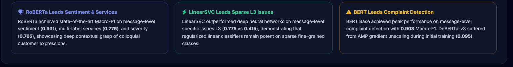

---

### 4. Batch CSV Processing & REST API

Engineered for enterprise high-throughput offline batch analysis and daily ticket audits.

#### Step 1: Uploading Operational Datasets
1. Navigate to the **"Batch & REST API"** tab.
2. Drag and drop any `.csv` file (e.g., `test.csv` included in the root folder).
3. Specify the target text column (default: `text`) and row processing limit (e.g., 50, 100, 200, 500, or All).
4. Click **"Execute Batch Inference"**.

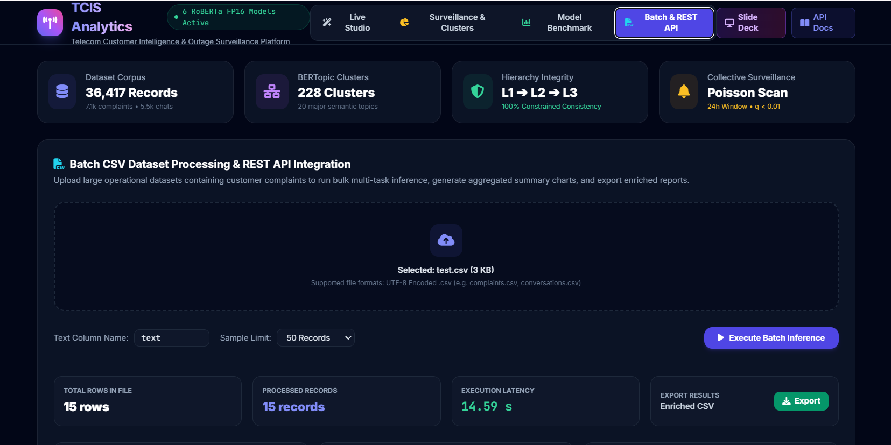

#### Step 2: Instant Aggregated Analytics & Enriched Export
- **Aggregated Performance Metrics**: Total rows parsed, successfully processed records, and execution latency.
- **Distribution Visualizations**:
  - *Complaint Ratio Pie Chart*: Instant visual breakdown of Complaint vs. Non-Complaint vs. Ambiguous records.
  - *Sentiment Distribution Bar Chart*: Proportions of Negative, Neutral, and Positive messages.
  - *Top Reported Services Chart*: Ranked frequency of affected service domains.
- **Classified Dataset Records Preview**: Tabular preview displaying original text, inferred complaint status, sentiment, L1 service, L2 category, nearest cluster ID, and urgency score.
- **One-Click Enriched Export**: Click **"Export Enriched CSV"** to download the dataset augmented with all model predictions and triage scores.

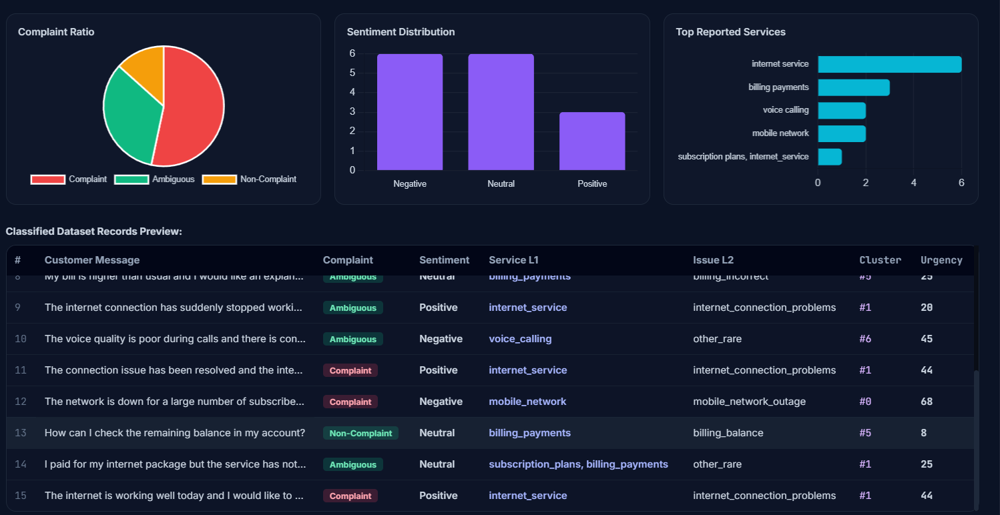

---

## 📐 Mathematical Surveillance Formulations

### 1. Poisson Scanning Window Formulation
For a cluster $c$ with baseline historical arrival rate $\lambda_c$ (complaints per hour) over a sliding surveillance window $W = 24\text{ hours}$, the expected baseline count is:
$$\mu_c = \lambda_c \cdot W$$

The probability of observing $k$ or more complaints under stationary Poisson assumptions is defined as:
$$P(X \ge k) = 1 - \sum_{j=0}^{k-1} \frac{\mu_c^j e^{-\mu_c}}{j!} = \frac{\gamma(k, \mu_c)}{(k-1)!}$$
Where $\gamma(k, \mu_c)$ is the lower incomplete gamma function. An alert is flagged when $P(X \ge k) < 0.001$.

### 2. Benjamini–Hochberg False Discovery Rate (FDR)
To control false alarms across all $M = 228$ simultaneous clusters, scan probabilities are ranked $p_{(1)} \le p_{(2)} \le \dots \le p_{(M)}$. The adjusted $q$-value is computed as:
$$q_{(i)} = \min_{j \ge i} \left( \frac{M \cdot p_{(j)}}{j} \right)$$
A cluster is marked as an active operational anomaly if $q_{(i)} \le \alpha = 0.05$.

### 3. Z-Score Anomaly Metric
For daily service volume spikes against historical rolling 30-day mean $\mu_{\text{svc}}$ and variance $\sigma_{\text{svc}}$:
$$Z = \frac{x_t - \mu_{\text{svc}}}{\sigma_{\text{svc}}} \ge 3.0$$

---

## 📡 API Reference & Endpoints

| Method | Endpoint | Description | Payload / Response |
| :--- | :--- | :--- | :--- |
| `GET` | `/api/health` | Service status, PyTorch device & model load state | `{"status": "operational", "models_count": 6}` |
| `POST` | `/api/analyze` | Single message or multi-turn dialogue inference | `{"text": "..."}` $\to$ Full predictions & SLA score |
| `GET` | `/api/demo-samples` | Pre-configured telecom benchmark scenario inputs | `{"samples": [...]}` |
| `GET` | `/api/topics` | BERTopic extracted clusters, keywords & distribution | `{"total_clusters": 228, "topics": [...]}` |
| `GET` | `/api/collective-alerts` | 24h Poisson anomaly alerts & daily $Z$-score surges | `{"active_collective_alerts": [...]}` |
| `GET` | `/api/model-comparison` | Official test set Macro-F1 benchmark evaluation matrix | `{"matrix": [...]}` |
| `POST` | `/api/batch-csv` | Multipart CSV file upload for bulk inference | Multipart Form $\to$ Aggregated metrics & rows |

---

## 📂 Directory Structure

```
tcis_models_archive_optimized/
├── engine.py                               # Core PyTorch RoBERTa inference engine
├── main.py                                 # FastAPI REST backend & API routing
├── run_server.py                           # Automated multi-platform launcher script
├── run_tcis.bat                            # Windows one-click desktop batch launcher
├── presentation.html                       # 7-Slide executive presentation deck
├── README.md                               # Enterprise documentation & user guide
├── tcis_taxonomy.json                      # Strict L1 ➔ L2 ➔ L3 hierarchical mappings
├── tcis_topics_and_alerts.json             # 228 BERTopic clusters & Poisson alerts data
├── test.csv                                # Sample CSV dataset for batch evaluation
├── images/                                 # Platform screenshots & UI assets
│   ├── 01_live_studio_input.png
│   ├── 02_live_studio_inference.png
│   ├── 03_live_studio_visuals.png
│   ├── 04_collective_alerts.png
│   ├── 05_cluster_distribution.png
│   ├── 06_daily_spikes_and_explorer.png
│   ├── 07_benchmark_chart.png
│   ├── 08_benchmark_matrix_table.png
│   ├── 09_benchmark_takeaways.png
│   ├── 10_batch_processing_upload.png
│   └── 11_batch_processing_analytics.png
├── msg_complaint_roberta/                  # Complaint detection model weights (FP16)
├── msg_sentiment_roberta/                  # 4-way sentiment analysis model weights (FP16)
├── msg_severity_roberta/                   # Operational severity model weights (FP16)
├── msg_services_roberta/                   # Multi-label 13 services model weights (FP16)
├── msg_L2_roberta/                         # 38 problem categories model weights (FP16)
├── msg_L3_roberta/                         # 17 resolution paths model weights (FP16)
└── static/
    └── index.html                          # Single Page Application interactive dashboard
```

---

## 👥 Authors & Acknowledgments
- **Project**: Telecom Customer Intelligence System (TCIS)
- **Framework**: PyTorch, HuggingFace Transformers, FastAPI, Chart.js, Tailwind CSS
- **Deployment**: Local / On-Premise GPU & CPU High-Performance Serving
